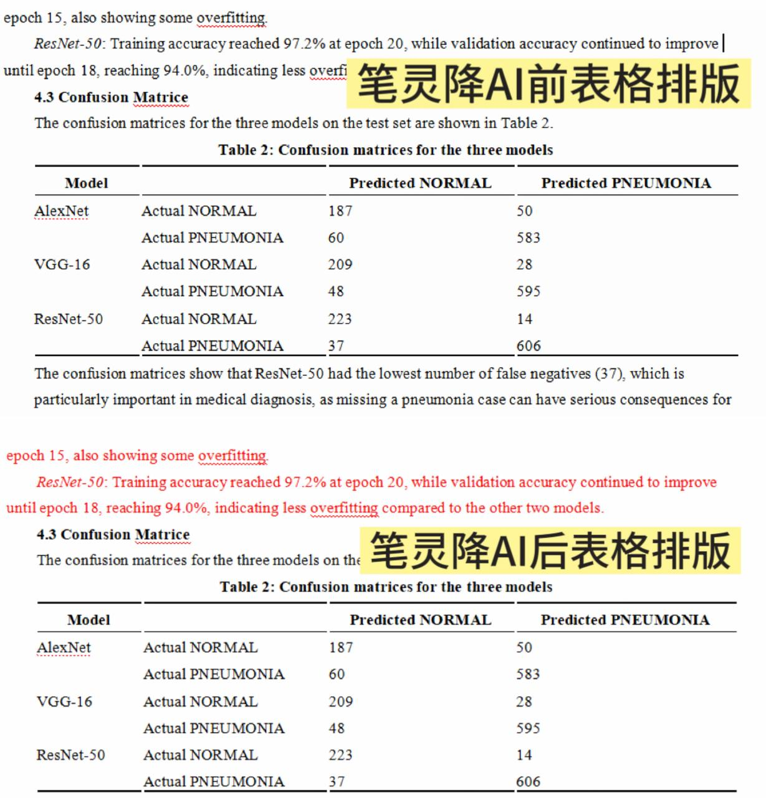

# 英文AI率高？4 种文稿优化思路，手把手教你降低英文AI率

平时在打磨英文长文稿的时候，不少小伙伴都会遇到同一个难题：自己一点点整理、撰写出来的内容，做完文本检测之后，AI 特征的结果却并不理想。 

很多人会到处查找**降 ai 率的方法**，挨个尝试各类线上**降 ai 率工具**，折腾很久，文稿的表达质感依旧没有改善。

我之前也一样，在踩了很多坑之后，慢慢总结出了一套实操性不错的文稿优化思路，如果你也在寻找合适的方式优化文本，这篇实测分享可以参考看看。

## 一、先理清：文稿模板感从何而来

很多人调整文稿时，习惯直接批量替换单词，这样做效果往往不理想。单纯替换词汇，文稿底层的句式逻辑、行文节奏不会改变，文本依旧会带有模板化痕迹。

模型产出的文字，句式排布规律性强，缺少个人写作习惯，我们调整文稿的核心，就是要打破这种固化表达，让文字更贴合个人写作风格。

## 二、4 种实用文稿优化思路

### 思路 1：重构叙事视角，换表达方式

如果段落模板感明显，不要直接丢进工具批量改写，容易破坏内容逻辑。 

操作方式：读完整个段落，理解核心观点，放下原文，用自己的口吻重新组织语句，这样重新写出来的内容句式变化自然，能有效**降低AI率**。

### 思路 2：补充细节描述，丰富内容层次

模板化文字往往内容偏概括，缺少细节信息。这也是很实用的**降 ai 率的方法**。 

举例：原句`The experiment obtained a set of valid data.` 

可以补充细节改写：`After repeated calibration of instrument parameters, we collected a set of valid data for subsequent comparative analysis.` 

加入过程类细节，增加个人写作痕迹，文稿的自然度会明显提升。

### 思路 3：拆分长句、合并短句，调整句式节奏

机器生成内容偏爱规整的长句，句式结构高度统一。，遇到一整句超长复合句，可以拆分成 2\-3 个短句；如果是零散短句堆砌，也可以适度合并。

只要打乱原本统一的句式长度，就能降低文章里的AI感。

### 思路 4：删减冗余套话，精简文本内容

模型很喜欢使用通用性强的套句，通读全文，筛选没有实质信息的通用表述，酌情删减。精简之后，文稿表达会更加凝练，减少 AI 风格的痕迹。

## 三、多款文本优化工具实测盘点

前面这几套手动优化思路，适合少量段落调整，如果文稿篇幅很长，纯手动修改会耗费大量时间，这段时间我测试了另外几款不同类型的文本优化工具，客观记录一下使用感受。

### 01、笔灵 AI

传送门： [笔灵英文降AIhttps://u\.ibiling\.cn](https://ibiling.cn/paper-pass/english?from=githubywjiangai1009jw) 

笔灵是我实测下来较适配英文长文稿的**降 ai 率工具**，在处理模板感较强的英文段落时，文稿自然度提升效果比较稳定。 

我也用过不少改写工具了嘛，笔灵给我的感受差别还是挺大的。它会先通读整篇文稿的上下文再调整句式，完整保留稿件原本的内容框架，不会随便乱改，这样去降低文稿里的模板痕迹就很自然。

我自己实测最喜欢它的固定词锁定功能，像专业术语、实验数据这些关键内容，我都可以提前锁定住，这样一来，工具只会调整语句的表达，完全不会动这些核心信息，专业内容的准确性就不用担心。

与此同时，文稿自带的表格、注释、段落格式都能保留，不用后续重新排版，这样我们就可以节省大量反复修改和排版的时间，方便大家把精力放在内容创作本身。

### 02、SpeedAI

SpeedAI 上手门槛很低，改写响应速度很快，自带简易版英文 AI 自查功能，很适合临时救急，用来处理短句或者小段文本的基础润色。

不少刚接触英文文稿优化的新手，搜免费工具的时候第一个刷到的就是它，但短板也很明显，它只能做基础的长句拆分、简单换词，改动只停留在文本表面。

我觉得它比较适合拿来当个备用工具，用于给短一些的文章简单微调，不适合当成主力改稿软件。

### 03、降重鸟

这款工具的新用户注册有免费试用，主打英文润色，是轻量化的英文文稿优化工具，我实测下来，改写后的语句读起来还算通顺，基本不会出现语法问题，简单调换语序、替换单词这类操作都能搞定。

问题就是改写深度偏弱，碰到 AI 常生成的长复合从句，很难彻底拆解，没办法从根源打破模板化的行文习惯，如果你的文稿机器感很重，单独用它效果就会比较差了，适合搭配主力工具，用来打磨表层细节。

## 最后的小结：怎么搭配工具更高效

分享这一套**降 ai 率的方法**，也是希望打磨英文稿件的小伙伴，不用一直埋头手动反复修改。 

大家体验各类**免费降 ai 率工具**时理性看待，免费工具大多只能完成轻度文本调整，文稿优化这件事，工具只能作为辅助，文章核心观点与内容，依旧需要创作者自己把控。

推荐的组合方式：先用免费工具筛查标记模板感强的段落，手动做基础调整，最后使用笔灵完成全文精修与格式保存，这样可以合理搭配工具，减少重复劳动，把重心放在内容本身哦\~

